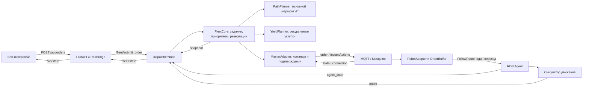
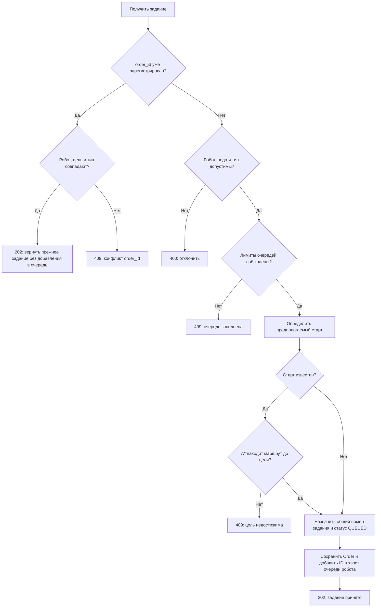
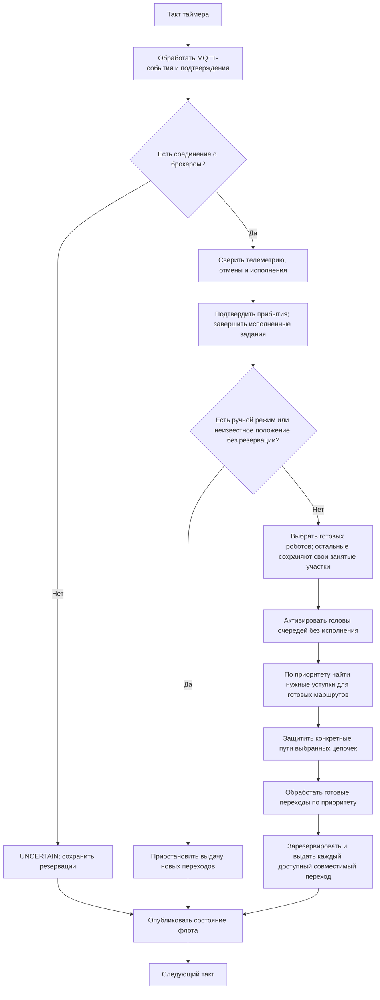
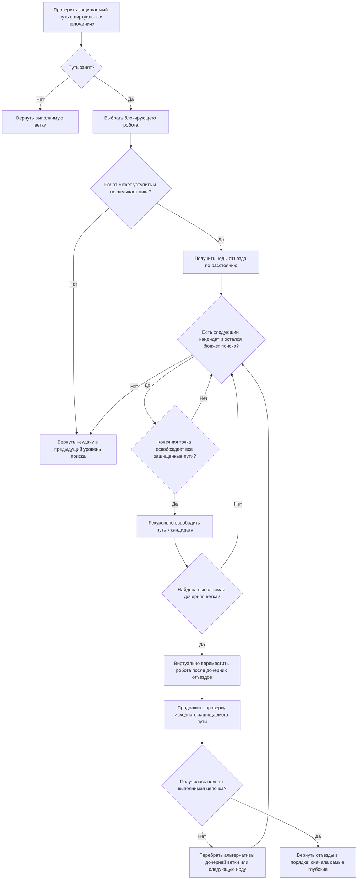
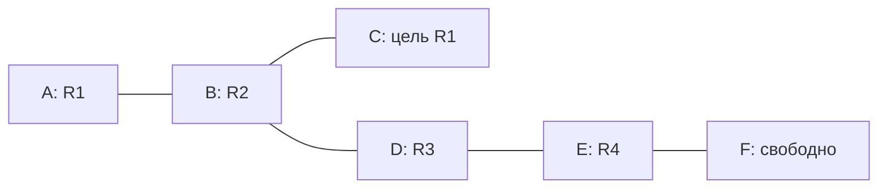
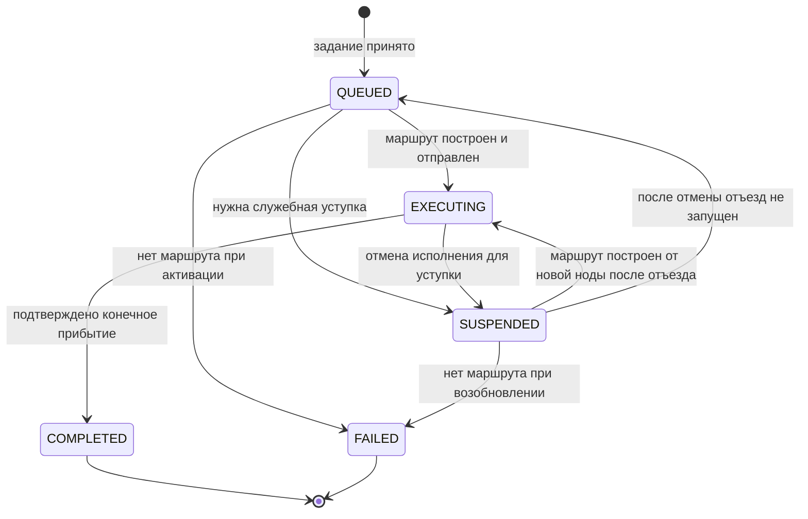

# Диспетчер флота: алгоритм, очереди и рекурсивные уступки

Документ описывает текущую реализацию Warehouse RMS2. Диспетчер принимает задания,
хранит отдельную FIFO-очередь каждого робота, строит маршруты и разрешает движение
по одному переходу. На каждом такте разрешаются все проверенные совместимые
переходы. При конфликте преимущество имеет более раннее задание, а мешающие
роботы освобождают путь рекурсивной цепочкой отъездов. Независимые перемещения
и уступки могут идти одновременно.

Схемы записаны в Mermaid. Для их отображения нужен Markdown-просмотрщик
с поддержкой Mermaid; подписи и текстовые примеры позволяют читать документ
и без визуализации.

## Содержание

1. [Архитектура и поток данных](#1-архитектура-и-поток-данных)
2. [Задание, исполнение и робот](#2-задание-исполнение-и-робот)
3. [Виды очередей и их лимиты](#3-какие-очереди-существуют)
4. [Прием задания и защита от повторов](#4-прием-задания-и-защита-от-повторов)
5. [FIFO и общий приоритет](#5-fifo-и-общий-приоритет)
6. [Построение основного маршрута](#6-построение-основного-маршрута)
7. [Основной цикл диспетчера](#7-основной-цикл-диспетчера)
8. [Base/Horizon и резервации](#8-разрешение-движения-basehorizon-и-резервации)
9. [Рекурсивное освобождение маршрута](#9-рекурсивное-освобождение-маршрута)
10. [Исполнение цепочки уступок](#10-как-рассчитанная-цепочка-исполняется)
11. [Ожидание после уступки и возврат к FIFO](#11-ожидание-после-уступки-и-возврат-к-fifo)
12. [Пошаговые примеры](#12-примеры)
13. [Статусы задания и робота](#13-статусы-задания-и-статусы-робота)
14. [Доставка команд, сбои и перезапуски](#14-доставка-команд-сбои-и-перезапуски)
15. [Наблюдение за очередями и ожиданием](#15-наблюдение-за-очередями-и-ожиданием)
16. [Исходники и проверки](#16-исходники-и-проверки)

## 1. Архитектура и поток данных



Компоненты разделяют ответственность:

| Компонент | Назначение |
| --- | --- |
| `DispatcherNode` | ROS-подписки, сервис приема заданий, таймер, публикация состояния флота. |
| `FleetCore` | Очереди, выбор приоритета, синхронизация, выдача переходов, учет выполнения и уступок. |
| `PathPlanner` | Направленный граф карты и поиск основного маршрута A*. |
| `YieldPlanner` | Поиск выполнимой цепочки отъездов с возвратом к альтернативным точкам. |
| `MasterAdapter` | Формирование VDA-команд, повторная отправка, ожидание подтверждений. |
| `RobotAdapter` | Прием VDA-команд, журналирование, запуск разрешенного перехода через ROS. |
| `OrderBuffer` | Хранение текущего Base/Horizon на стороне робота. |

Сетевые потоки MQTT не изменяют состояние `FleetCore` напрямую. Входящие сообщения
проходят валидацию и поступают в очередь событий. `MasterAdapter.poll()` обрабатывает
эти события в цикле диспетчера, после чего `FleetCore.tick()` принимает решения.

## 2. Задание, исполнение и робот

### Пользовательское задание — `Order`

Задание хранит намерение пользователя: **какой робот должен приехать в какую точку**.

| Поле | Смысл |
| --- | --- |
| `order_id` | Идентификатор пользовательского задания и ключ защиты от повторной постановки. |
| `robot_id` | Робот, которому назначено задание. |
| `target` | Конечная нода карты. |
| `kind` | `MOVE` или `PARK`. Для `PARK` цель должна быть парковочной нодой. |
| `number` | Общий порядковый номер приема задания в пределах запуска диспетчера. |
| `status` | `QUEUED`, `EXECUTING`, `SUSPENDED`, `COMPLETED` или `FAILED`. |
| `route` | Маршрут, построенный при активации; после уступки может быть перестроен. |

### Текущее исполнение — `Execution`

Исполнение хранит **конкретный маршрут и выданные разрешения на его прохождение**.
У робота одновременно может быть не более одного такого исполнения.

| Поле | Смысл |
| --- | --- |
| `execution_id` | Отдельный UUID исполнения; передается роботу как VDA `orderId`. |
| `route` | Последовательность нод текущего маршрута. |
| `version` | Отправленная версия VDA-заказа, то есть `orderUpdateId`. |
| `confirmed_version` | Последняя подтвержденная актуальная версия исполнения. |
| `completed` | Индекс последней подтвержденно достигнутой ноды. |
| `released` | Индекс последней ноды, до которой уже разрешено движение. |
| `grant_at` | Момент выдачи последнего перехода. |
| `service` | Признак служебного отъезда для уступки. |
| `yield_forbidden_nodes` | Ноды, которые служебный маршрут не должен пересекать. |

`Order.order_id` и `Execution.execution_id` имеют разные назначения. После отмены
и перестроения маршрута пользовательское задание сохраняет свой ID и приоритет,
а новое исполнение получает другой UUID и начинает нумерацию версий с нуля.

### Состояние робота — `Robot`

У робота хранятся очередь ID заданий, текущее исполнение, положение, скорости,
свежесть одометрии и сообщений агента, MQTT-состояние, резервация перехода,
блокирующие роботы, ожидаемая отмена и признаки ожидания после уступки.

`clearance_for` связывает участника с исходным приоритетным исполнением.
`clearance_paths` содержит пути выбранной ветки освобождения: путь текущего
участника и отъезды его предков. Эти сведения защищают конкретные проходы
и обеспечивают наследование приоритета; они не запрещают всю собственную очередь
до завершения чужого задания.

Фактическое положение берется из одометрии. Ближайшая нода считается текущей,
только если робот находится от нее не дальше `tolerance`, по умолчанию **0,15 м**.

## 3. Какие очереди существуют

В системе несколько независимых механизмов хранения и ожидания:

| Механизм | Содержимое | Когда освобождается |
| --- | --- | --- |
| `Robot.queue` | FIFO из ID пользовательских заданий одного робота. | Головное задание удаляется после завершения либо ошибки построения маршрута при активации. |
| `FleetCore.orders` | Словарь принятых заданий, включая завершенные и неуспешные. | При завершении процесса диспетчера; отдельной очистки истории в текущем ядре нет. |
| `MasterAdapter.pending` | Одна ожидающая подтверждения VDA-команда на робота. | После подходящего `state`, подтверждающего заказ или результат действия. |
| `MqttClient.work` | Задания на проверку входящих и исходящих сообщений. | После обработки рабочим потоком. |
| `MqttClient.events` | Проверенные сетевые события для ROS-цикла. | При чтении через `drain()`. |
| `OrderBuffer` | Один текущий VDA-заказ: ноды, ребра, Base/Horizon и прогресс. | Исполнение заканчивается или отменяется; запись последнего заказа может оставаться в буфере. |

`OrderBuffer` не содержит FIFO пользовательских целей. Например, три задания
«доехать в B, затем в C, затем припарковаться в P1» находятся в RMS, а адаптер
получает исполнение только текущего задания.

Лимиты пользовательских очередей:

- **16 заданий на робота**;
- **512 заданий суммарно на парк**.

В лимит входят выполняемое головное задание, приостановленное задание и ожидающие
задания. Завершенные записи в `orders`, уже удаленные из очередей, лимит не занимают.
Служебный отъезд не добавляет пользовательское задание и не расходует этот лимит.

Сетевые очереди `work` и `events` имеют собственные лимиты по 512 элементов.
Эти значения не означают, что MQTT хранит пользовательскую очередь флота.

## 4. Прием задания и защита от повторов

Пример запроса:

```http
POST /api/orders
Content-Type: application/json

{
  "robot_id": "robot_01",
  "target_node_id": "R2C4",
  "order_type": "MOVE",
  "order_id": "delivery-001"
}
```

Веб-сервер проверяет формат запроса и вызывает ROS-сервис `/fleet/submit_order`.
Сервис передает данные в `FleetCore.submit()`.



Предполагаемый старт для предварительной проверки выбирается так:

1. Если очередь непустая — цель последнего задания в этой очереди.
2. Если очередь пустая — текущая подтверждаемая по одометрии нода робота.
3. Если текущая нода неизвестна — проверка достижимости откладывается до активации.

Предварительная проверка подтверждает связность карты, но не резервирует путь
и не означает немедленное начало движения. Пока задание ожидает, `route` может
быть пустым. Ответ `202` означает прием задания, а не его выполнение.

Если `order_id` не передан, ядро создает UUID. Для безопасного повтора запроса
после потери ответа следует передавать свой стабильный `order_id`: повтор с теми
же параметрами вернет прежнее задание, в том числе если оно уже завершено.
Другой робот, цель или тип с тем же ID дают `409`.

Ошибки формата HTTP-запроса обрабатываются веб-валидацией отдельно. Недоступность
ROS-сервиса или таймаут ответа возвращаются веб-сервером как `503`; при таймауте
результат постановки может быть неизвестен клиенту.

## 5. FIFO и общий приоритет

У каждого робота собственная очередь. Выполняемое задание остается ее первым
элементом до подтвержденного завершения. Следующие задания не обходят голову.

```text
robot_01.queue = [O1: EXECUTING, O4: QUEUED, O7: QUEUED]
robot_02.queue = [O2: EXECUTING, O5: QUEUED]
robot_03.queue = [O3: QUEUED]
```

Базовый приоритет определяется номером головы очереди. Для выдачи переходов
используется ключ:

```text
(номер задания, признак обычного движения, robot_id)
```

Чем меньше номер, тем выше приоритет. Он назначается при приеме и общий для всего
парка. Участник активного освобождения наследует номер исходного задания и
обрабатывается перед его обычным движением: сначала нужно сохранить выезд.
Это относится и к естественному отъезду по собственному маршруту, если он принят
как первый шаг цепочки. Без очереди и без активной уступки приоритет равен `+∞`.
`robot_id` разрешает оставшееся равенство.

Это не одна глобальная очередь, строго выполняемая по одному заданию. Независимые
маршруты двигаются одновременно. Дальний невыданный участок обычного маршрута
не резервирует весь коридор: другой робот может безопасно пересечь его до приезда
владельца. Если два готовых перехода конфликтуют сейчас, первым резервируется
переход более приоритетного робота, а второй ждет освобождения резервации.

Освобождение путей рассматривается для всех готовых исполнений в порядке
приоритета. Независимая поздняя цепочка может выполняться одновременно с ранним
заданием. Ее служебный путь не прокладывается через оставшийся обычный маршрут
более раннего исполнения и уже защищенные пути других активных цепочек.

Когда головное задание завершается, оно удаляется, и приоритет робота определяется
следующей головой. Номер следующего задания не изменяется.

## 6. Построение основного маршрута

`PathPlanner` создает направленный граф `networkx.DiGraph`:

- ноды карты становятся вершинами;
- ребро задает разрешенное направление `source → target`;
- обратное направление добавляется только при `bidirectional=true`;
- вес ребра равен евклидову расстоянию между концами.

Основной маршрут строится A* с оценкой расстояния до цели по прямой:

```text
стоимость перехода = длина ребра
эвристика = расстояние по прямой до цели
результат = [текущая нода, ..., целевая нода]
```

При активации задания маршрут строится заново от фактической ноды остановившегося
робота. Путь предварительной проверки при приеме не фиксируется как исполнение.
При совпадении старта и цели получается маршрут из одной ноды.

A* минимизирует длину. Занятость, скорости, повороты и время ожидания не входят
в его вес. Стены, габариты и другие роботы проверяются при планировании уступок
и выдаче переходов. Маршрут приоритетного исполнения сохраняется при расчете
уступок; поиск не заменяет его объездом.

Если при активации пути до цели нет, головное задание получает `FAILED` и удаляется
из очереди. Остальные задания сохраняются. После служебного отъезда направленная
связность может отличаться от той, которая была проверена при приеме задания.

## 7. Основной цикл диспетчера

`DispatcherNode` создает таймер с периодом **0,1 с**. Это целевой период обработки,
а не гарантия жесткого реального времени. На каждом вызове последовательно:

1. `MasterAdapter.poll()` принимает проверенные сетевые события и обслуживает повторы.
2. `FleetCore.tick()` обновляет прогресс и принимает решения о движении.
3. `snapshot()` публикуется в `/fleet/state`.



В список готовых попадают роботы, прошедшие синхронизацию. Для каждого из них:

1. Ошибка исполнения или агента останавливает выдачу новых разрешений этому роботу.
2. Голова очереди может активироваться сразу после отъезда; ожидание проверяется для конкретного перехода.
3. Если исполнения нет, но есть очередь и робот остановился в ноде, активируется голова.
4. Для текущего исполнения ожидается подтверждение отправленной версии.
5. Пока разрешенный переход не завершен, следующий не выдается.
6. Проверяются приоритет, локальные защиты цепочек, занятость и статическая геометрия.
7. Только после успешных проверок резервируется и разрешается один переход.

При неизвестном положении с сохраненной резервацией робот может находиться
между ее концами: резервация продолжает защищать участок. Неизвестное положение
без такой резервации или ручной режим приостанавливают новые разрешения парку.
Просроченная телеметрия исключает соответствующего робота из готовых;
известные положения и резервации при этом не освобождаются автоматически.
Робот с известным положением, который еще сверяет старое исполнение, не останавливает
независимое движение остальных. Они по-прежнему учитывают его положение и резервацию.

## 8. Разрешение движения: Base/Horizon и резервации

Маршрут передается как VDA5050-заказ с двумя частями:

- **Base** — уже разрешенная часть;
- **Horizon** — известное продолжение, по которому двигаться еще нельзя.

Первый заказ содержит в Base только стартовую ноду. Все дальнейшие переходы
остаются в Horizon. Наличие полного маршрута у робота не дает разрешения
самостоятельно пройти его целиком.

Пример для маршрута `[A, B, C]`:

| Стадия | `version` | `completed` | `released` | Что разрешено |
| --- | --- | --- | --- | --- |
| Отправлен первый заказ | 0 | 0 | 0 | Оставаться в A. |
| Версия 0 подтверждена, переход свободен | 1 | 0 | 1 | Пройти A → B. |
| Подтверждено прибытие в B | 1 | 1 | 1 | Оставаться в B до следующего разрешения. |
| Выдан следующий переход | 2 | 1 | 2 | Пройти B → C. |
| Подтверждено прибытие в C | 2 | 2 | 2 | Завершить задание. |

При выдаче перехода ядро сохраняет `reserved=(a,b)`, увеличивает `released`
и `version`, записывает `grant_at` и отправляет обновление. На стороне робота
`OrderBuffer.next_step()` возвращает только разрешенную пару нод. Адаптер
передает эту пару агенту через `FollowRoute`.

### Геометрическая проверка

Робот приближенно рассматривается как круг радиусом:

```text
radius = sqrt(length² + width²) / 2
```

Проверяются весь отрезок предполагаемого движения, положения остальных роботов
и их зарезервированные отрезки. Конфликт существует при:

```text
расстояние между отрезками ≤ radius_1 + radius_2 + 2 × tolerance
```

Это учитывает встречное движение, пересечение разных ребер и занятость точек.
Для проверки стен и границ используется `CollisionChecker` с радиусом
`radius + tolerance`. Резервация защищает весь переход, включая его концы.
Результат проверки статического просвета кэшируется внутри экземпляра `FleetCore`:
карта и зарегистрированные габариты в текущем запуске постоянны. Занятость роботами,
их положения и резервации проверяются заново при каждой выдаче.

### Подтверждение прибытия

Резервация снимается после согласования нескольких признаков:

- VDA-состояние относится к ожидаемому исполнению и его актуальной версии;
- номер достигнутой ноды равен последней разрешенной ноде;
- `driving=false`;
- свежая одометрия подтверждает остановку именно в нужной ноде;
- одометрия получена позже выдачи разрешения `grant_at`.

Для остановки обе скорости должны быть по модулю меньше **0,001**, а статус агента
должен быть одним из `IDLE`, `PARKED`, `WAITING`, `STOPPED`. По умолчанию одометрия,
состояние агента и MQTT-state должны быть моложе **2 с**.

Последнее прибытие завершает задание только при пустом остатке VDA `nodeStates`.
Голова очереди удаляется, запись получает `COMPLETED`, исполнение очищается.

## 9. Рекурсивное освобождение маршрута

### Когда начинается поиск

`_resolve()` обрабатывает готовые обычные исполнения по приоритету. Поиск
возможен, когда робот остановился в ноде,
не держит незавершенную резервацию и не ожидает отмены.

Диспетчер проверяет весь оставшийся маршрут. Это позволяет освободить дальнюю
точку до того, как приоритетный робот подъедет и перекроет выезд мешающему.
Для одного исходного исполнения одновременно обслуживается одна активная ветка.
Независимые ветки других роботов могут рассчитываться и выполняться в том же такте.

Перед отменой проверяется естественный отъезд: если мешающий робот уже может
пройти свой следующий переход и не перекроет выезд, он продолжает текущее
исполнение. Отмена, служебный заказ и повторная активация в этом случае не нужны.
Если собственный путь совпадает с первым отъездом рассчитанной ветки, ему можно
временно передать приоритет исходного задания и защитить пути предков без отмены.

### Кого можно включить в цепочку

Робота можно попросить уступить, если:

- его приоритет ниже приоритета исходного задания;
- он синхронизирован, имеет свежую телеметрию и остановился в ноде;
- у него нет ошибки, резервации, незавершенной отмены или неопределенной команды;
- обычное исполнение, если оно есть, подтверждено и не имеет незавершенного перехода;
- он не выполняет уже начатый служебный маршрут;
- он не удерживается для другого, еще более раннего приоритетного исполнения.

Наличие своей пользовательской очереди не запрещает уступку. Эта очередь
сохраняется, а ее головное задание временно получает `SUSPENDED`.

### Виртуальные положения и защищенные пути

`YieldPlanner.plan()` сначала рассчитывает цепочку без отправки команд. В расчете
используются копии положений роботов, направления ребер, габариты и резервации.
При виртуальном отъезде меняется только положение в исследуемой ветке поиска.
Одна попытка освобождает конкретного мешающего робота вместе с его рекурсивными
зависимостями. Не требуется заранее освободить весь оставшийся маршрут, чтобы
приоритетный робот мог ехать по его свободной части.

Для очередного уступающего робота защищаются:

1. Весь оставшийся маршрут исходного приоритетного робота.
2. Маршруты отъезда предыдущих участников текущей рекурсивной ветки.

Конечная точка отъезда должна находиться вне всех этих маршрутов с учетом
геометрического просвета. Сам путь отъезда может проходить через еще не занятые
будущие участки этих маршрутов; их текущие занятые ноды пересекать запрещено.
Такой запрет действует и тогда, когда нода находится внутри длинного ребра.
Кроме того, служебный путь позднего задания не должен пересекать оставшиеся
обычные маршруты более ранних исполнений. Пути активных чужих цепочек учитываются
как временно занятые, включая еще не выполненные пути предков.

### Выбор ноды и возврат к альтернативе

Для уступающего робота строится представление направленного графа без запрещенных
нод, переходов через них и переходов с недостаточным статическим просветом.
Дейкстра вычисляет длины и по одному кратчайшему пути до достижимых нод.
Кандидаты перебираются по длине, при равенстве — по ID ноды.

Если выбранный путь занят, поиск рекурсивно пытается отвести блокирующего робота.
Если нижняя ветка не выполняется, перебираются ее альтернативы, затем другие
точки отъезда предыдущего участника. Виртуальные перемещения неудачной ветки
отбрасываются. Отмен и команд движения для нее не отправляется.



Уже перемещенный виртуально робот фиксируется в текущей ветке: его не двигают
второй раз в том же плане. Предки рекурсии также не могут становиться ее
очередными уступающими участниками. Это исключает циклические зависимости.

Бюджет одной попытки — **2000 шагов поиска**. Он расходуется на проверки путей
и перебор кандидатов; это не число роботов и не гарантированное время в миллисекундах.
При исчерпании бюджета диспетчер сообщает о лимите и ждет следующего такта.
Поиск не гарантирует минимальную суммарную длину всех отъездов или решение любой
теоретически разрешимой перестановки: перебираются кратчайшие пути к кандидатам,
в одной ветке запрещено повторное перемещение участника, а бюджет конечен.

### Безопасный подход к занятому тупику

Свободный следующий переход сам по себе еще не означает, что можно перекрыть
единственный выезд дальнему роботу. Перед таким подходом выполняется статическая
проверка тем же поиском: сможет ли стоящий впереди робот отступить, если следующая
нода станет недоступна. В этой проверке временная занятость другими роботами
игнорируется, а направления, просвет и защищаемый маршрут сохраняются.

Если после подхода не остается ни одного статического отъезда, приоритетный робот
ждет освобождения выезда. Иначе он продолжает свободный префикс. Для уже начавшего
отъезд робота работают его физическая резервация и защиты выбранной цепочки.

## 10. Как рассчитанная цепочка исполняется

План возвращается в порядке «сначала самый глубокий участник». Для одной ветки
в работу берется **только первый отъезд**. Его собственный путь и отъезды предков
сохраняются как временные защиты в `clearance_paths`.

Это не резервирование всего флота. Например, пока последний участник отходит,
приоритетный робот может пройти свободный начальный участок, но не должен занять
ноду, через которую затем будет выезжать предыдущий участник. Независимые
пользовательские переходы и другие цепочки при этом разрешены.

Если у робота есть исполнение, которым нельзя выполнить подходящий отъезд:

1. Запоминаются маршрут отъезда, исходный приоритетный робот и запрещенные ноды.
2. Его головное пользовательское задание отмечается `SUSPENDED`.
3. Отправляется `cancelOrder` с отдельным ID действия.
4. Диспетчер ждет подтверждения отмены и остановки в ноде.
5. Проверяется, что исходное приоритетное исполнение все еще имеет прежний ID.
6. Путь проверяется повторно по свежему состоянию, затем запускается служебное исполнение.

Отмена считается подтвержденной по `actionStates`. Допустим также частный ответ
`FAILED` с описанием `No active order to cancel`, если у робота нет `nodeStates`;
остановка в ноде все равно обязательна. Произвольная ошибка отмены таким подтверждением
не считается.

Для любого плана сохраняется выбранный путь первого участника: перед запуском
проверяются старт, занятость, запрещенные ноды и просвет. Если путь после отмены
больше не подходит, он не выполняется. Общий поиск заново подбирает ветку по
свежему состоянию; отдельного алгоритма одиночной уступки нет.

Если исполнения не было, служебный маршрут можно создать сразу. Он проходит
обычный механизм версий, подтверждений и выдачи по одному переходу.

Ожидание отмены и подтверждения заказа касается соответствующего робота.
Другие роботы продолжают движение, если их переходы не конфликтуют с занятыми
участками и защищенными путями цепочки. Прием заданий в очереди продолжается.

После подтвержденного завершения отъезда поиск выполняется заново по актуальным
положениям. Теперь может стать выполнимым отъезд предыдущего участника цепочки.
Уже свободные переходы исходного маршрута могут выполняться одновременно с этим
процессом. После достижения цели первого отъезда его временные защиты удаляются,
а новая ветка, если нужна, рассчитывается заново перед выдачей переходов.

## 11. Ожидание после уступки и возврат к FIFO

Участник цепочки запоминает `clearance_for=(robot_id, execution_id)` исходного
приоритетного исполнения. Эта связь используется для наследования приоритета
во время освобождения и для проверки конкретных последующих переходов.

После завершения отъезда голова своей очереди может сразу активироваться от новой
ноды. Проверяется следующий переход:

- если он не мешает оставшемуся маршруту исходного робота и другим активным
  цепочкам, робот едет;
- если он возвращает робота на еще защищаемый участок, робот ждет перед этим
  переходом, сохраняя очередь;
- если исходный робот уже прошел общий участок, движение разрешается, даже если
  его задание еще не закончилось.

Когда исходное исполнение завершается или заменяется другим ID, связанное с ним
ограничение снимается. Отдельного `hold` и ожидания полного чужого задания нет.

```text
до уступки:       queue = [O2, O5], execution = пользовательский путь к цели O2
во время уступки: queue = [O2, O5], execution = служебный путь
после отъезда:    queue = [O2, O5], новое исполнение от новой ноды к цели O2
следующий шаг:   ехать, если переход свободен; иначе ждать конкретного участка
после цели O2:    queue = [O5]
```

ID, номер, цель и порядок пользовательских заданий сохраняются. Геометрический
маршрут уступившего робота может измениться, поскольку его фактический старт другой.
Свободный робот без заданий остается в точке отъезда; если он мешает следующему
приоритетному заданию, ему может потребоваться еще одна уступка.

## 12. Примеры

### Цепочка из трех уступающих роботов

У `R1` самое раннее задание: проехать `A → B → C`. В B стоит R2, в D стоит R3,
в E стоит R4. F свободна. Между B, D, E и F есть проход.



Направления движения определяются картой; в этом примере связи двусторонние.

| Шаг | Решение | Результат |
| --- | --- | --- |
| 1 | R2 должен покинуть B и выбирает D. | D занята R3. |
| 2 | Для R3 выбирается E. | E занята R4. |
| 3 | Для R4 выбирается F. | Цепочка целиком выполнима. |
| 4 | Выполняется R4: E → F. | E освобождается; поиск повторяется. |
| 5 | Выполняется R3: D → E. | D освобождается; поиск повторяется. |
| 6 | Выполняется R2: B → D. | Маршрут R1 освобожден. |
| 7 | R1 проходит A → B → C. | Приоритетное задание завершается. |
| 8 | R2, R3 и R4 продолжают свои очереди по доступным переходам. | Это возможно и до конца задания R1, если пути уже не конфликтуют. |

### Тупиковая ближайшая нода

R2 мешает маршруту R1 в B. Ближайшая точка отъезда — D, но там стоит R3.
Единственный выход R3 проходит обратно через B, где находится R2.
Такой вариант не освобождает место для R2 и отбрасывается.

Если из B доступна другая нода E, планировщик пробует `B → E`, даже если путь
длиннее. R3 остается в D. Команда двигаться в тупиковую D не отправляется.

Если альтернатив нет, приоритетное задание сохраняется. Свободные безопасные
переходы до препятствия могут выполняться; перед самим препятствием робот ждет
с объяснением занятого пути и неудачи поиска. Его маршрут не заменяется объездом.

### Независимые движения во время уступки

Пока R2 освобождает проход для R1, робот R5 на другой стороне склада продолжает
свое задание. Если на его пути требуется отдельная уступка R6, она тоже может
выполняться одновременно. Для каждого нового перехода проверяются общие
геометрические резервации и защиты обеих цепочек.

## 13. Статусы задания и статусы робота

Это разные уровни состояния. Например, пользовательское задание может оставаться
`EXECUTING`, пока робот имеет статус `WAITING` перед занятым переходом.



Статусы робота, используемые снимком диспетчера:

| Статус | Значение |
| --- | --- |
| `SYNCHRONIZING` | Начальное ожидание телеметрии и обмена. |
| `IDLE` | Нет активного исполнения, требующего движения или ожидания. |
| `EXECUTING` | Создан и отправлен пользовательский маршрут. |
| `MOVING` | Выдан пользовательский переход; ожидается его прохождение. |
| `YIELDING` | Выполняется служебное освобождение пути. |
| `WAITING` | Движение ожидает свободного перехода, выезда другого робота, отмены или освобождения защищаемого участка. |
| `UNCERTAIN` | Нет необходимых подтверждений, телеметрии или согласованного состояния; либо обнаружена ошибка. |

Робот в ожидании следующей разрешенной части Base не считается застрявшим только
из-за такого ожидания. Runtime-ошибка VDA не переводит пользовательское задание
автоматически в `FAILED` и не удаляет его из очереди: оно сохраняется для восстановления.

## 14. Доставка команд, сбои и перезапуски

### Подтверждения и повторы

Публикация MQTT-команды не является подтверждением ее принятия. Заказ подтверждается
через `state` с ожидаемыми `orderId` и `orderUpdateId`, действие отмены — по своему
`actionId` в `actionStates`.

Неподтвержденная команда повторяется примерно раз в секунду в пределах окна 5 с.
ID и содержимое команды сохраняются, транспортные заголовки обновляются.
После 5 с без подтверждения команда становится неопределенной; новые разрешения
для соответствующего исполнения не выдаются, резервации сохраняются.

При переподключении сначала сверяется актуальное состояние. Слепое продолжение
повторов до сверки не выполняется. Ожидающая сверки команда также считается
неопределенной, даже если новое окно повторов еще не началось.
MQTT-команды движения не публикуются retained;
адаптер также отклоняет retained-команды.

### Потеря связи

При потере MQTT диспетчер отмечает отсутствие соединения, приостанавливает новые
разрешения и сохраняет известные резервации. Адаптер не запускает следующий переход
без MQTT-соединения. Уже начатый локальный переход может завершиться, поэтому робот
завершает не более одного ранее разрешенного перехода, затем ожидает восстановления связи.

### Перезапуск диспетчера

Очереди, общий счетчик приоритетов, история `orders` и объекты исполнений находятся
в памяти RMS. После перезапуска они не восстанавливаются автоматически.

Новый диспетчер получает инвентарь, телеметрию и VDA-state. Старое исполнение
сверяется и отменяется после подтвержденной остановки в ноде. Если робот еще
проходит ранее разрешенный переход, диспетчер ждет завершения этого перехода.
Пользовательские задания после такого перезапуска нужно подать заново.

### Перезапуск адаптера

SQLite-журнал адаптера содержит квитанции приема команд и контрольный снимок
текущего VDA-заказа. Он защищает от повторного исполнения, но не является
постоянным хранилищем пользовательских очередей RMS.

Если при старте адаптера обнаружено незавершенное старое исполнение, оно отмечается
ошибкой и не продолжается автоматически. Журналы работающего адаптера удалять нельзя.

### Ручной режим

Ручное управление приостанавливает выдачу новых переходов парку. После выхода
из него в подтвержденной ноде прерванное исполнение отменяется, а пользовательская
цель сохраняется для перестроения. Если робот остановлен между нодами без
допустимой резервации, требуется восстановление положения; обычная очередь
сама по себе не разрешает движение из произвольной точки.

## 15. Наблюдение за очередями и ожиданием

Диспетчер публикует JSON в `/fleet/state`. Веб-мост передает его в поле `fleet`
снимка `/ws/state`.

| Поле робота в снимке | Как использовать |
| --- | --- |
| `status`, `message` | Текущее решение диспетчера и причина ожидания. |
| `order_id` | ID головы пользовательской очереди. |
| `vda_order_id` | ID текущего исполнения, в том числе служебного. |
| `order_update_id`, `confirmed_update_id` | Сравнение отправленной и подтвержденной версии. |
| `remaining_route` | Текущая и оставшиеся ноды исполнения; при уступке это служебный маршрут. |
| `yielding` | Выполняется ли служебное исполнение. |
| `blocking_robots` | Роботы, блокирующие проверяемый ближайший переход. |
| `queue` | Список пользовательских заданий с ID, целями, типами и статусами. |
| `mqtt_connected` | Соединение RMS с брокером и известный ONLINE-статус данного робота. |

`blocking_robots` не является готовым деревом всей рекурсивной цепочки. Причина
ожидания может относиться к дальнему участку маршрута, подтверждению команды или
удержанию после уступки, даже если этот список пуст.

Сравнивать состояние только по `mqtt_connected` недостаточно: отдельно нужны
свежесть телеметрии, совпадение версий, `status` и `message`.

## 16. Исходники и проверки

Основные реализации:

- [DispatcherNode](ros_ws/src/fleet_dispatcher/fleet_dispatcher/dispatcher_node.py) — ROS-интерфейс и периодический цикл.
- [FleetCore](ros_ws/src/fleet_dispatcher/fleet_dispatcher/core.py) — пользовательские очереди, приоритет, прогресс, резервации и уступки.
- [PathPlanner](ros_ws/src/fleet_dispatcher/fleet_dispatcher/planner.py) — основной маршрут A*.
- [YieldPlanner](ros_ws/src/fleet_dispatcher/fleet_dispatcher/yield_planner.py) — рекурсивный поиск и возврат к альтернативам.
- [MasterAdapter](ros_ws/src/vda_bridge/vda_bridge/master_adapter.py) — подтверждения и повторы команд.
- [OrderBuffer](ros_ws/src/vda_bridge/vda_bridge/order_buffer.py) — Base/Horizon на стороне робота.
- [RobotAdapter](ros_ws/src/vda_bridge/vda_bridge/robot_adapter.py) — выполнение переходов и журналирование.
- [Конфигурация VDA/MQTT](ros_ws/src/vda_bridge/config/vda5050.yaml) — брокер, период state и параметры профиля.

Сценарии поведения закреплены в тестах:

- [Очереди и уступки](tests/test_fleet_queue.py): FIFO, повторные ID, лимиты, возобновление, резервации и повторная уступка.
- [Рекурсивный поиск](tests/test_recursive_yield.py): глубокая цепочка, занятые участники, альтернативная нода, циклы, лимит поиска и повторная проверка после отмены.
- [Эффективность движения](tests/test_dispatch_throughput.py): параллельные цепочки, доступные префиксы, естественный отъезд, локальное возобновление и сохранение выезда из тупика.
- [ROS/MQTT-уступки](tests/test_yield_ros.py): реальные агенты, цепочка, тупиковая ветка и сохранение очередей занятых роботов.
- [Интеграция и перезапуски](tests/test_ros_vda_integration.py): очередь, восстановление MQTT и новый запуск диспетчера.

Значения 16/512, период 0,1 с, допуск 0,15 м, таймаут ядра 2 с,
окно подтверждения 5 с и бюджет 2000 описывают текущие значения по умолчанию
или константы реализации. Часть параметров задается YAML, часть — кодом ядра
и транспорта; изменение одного YAML не меняет автоматически все эти ограничения.

### Что означает «двигаться всегда, когда возможно»

На каждом такте диспетчер последовательно резервирует все допустимые переходы
готовых роботов с учетом приоритета. Отсутствие движения должно объясняться
конкретным ограничением: подтверждением, телеметрией, физической занятостью,
геометрией, защитой отъезда или риском перекрыть единственный выход.

Это локальная выдача совместимых переходов, а не доказательство глобально
оптимального расписания всего парка. Между переходами по-прежнему обязательны
остановка в ноде и подтверждение VDA; скорости агента и движения внутри перехода
этот рефакторинг не меняет.
