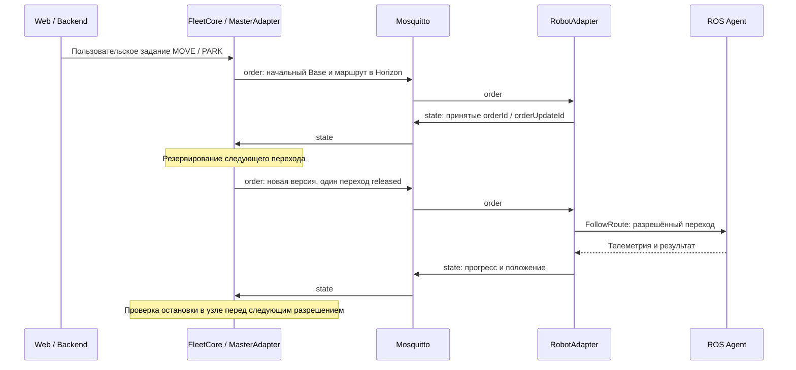

# Работа с брокером сообщений Mosquitto

Документ описывает использование Mosquitto в `warehouse-rms2` по текущему коду и конфигурации проекта.

## 1. Роль брокера в системе

Mosquitto — MQTT-брокер, через который диспетчер обменивается сообщениями с адаптерами роботов. Отправитель публикует сообщение в именованный канал — **топик**, а брокер передаёт его клиентам, подписанным на этот топик.

В проекте обмен устроен так:

```text
Веб-интерфейс → Backend / ROS → FleetCore → MasterAdapter
                                               ↕
                                           Mosquitto
                                               ↕
                                          RobotAdapter
                                               ↕
                                            ROS Agent
```

- **FleetCore** хранит пользовательские задания, планирует выполнение и резервирует участки карты.
- **MasterAdapter** преобразует решения диспетчера в сообщения ограниченного профиля VDA 5050 2.1.0 и обрабатывает ответы роботов.
- **Mosquitto** передаёт сообщения между подписчиками.
- **RobotAdapter** проверяет команды, хранит локальное состояние заказа и передаёт разрешённый переход ROS-агенту через action `FollowRoute`.
- **ROS Agent** выполняет движение и предоставляет локальную телеметрию.

Брокер не строит маршруты, не управляет резервациями и не решает, может ли робот начать движение. Эти решения принимают диспетчер и адаптер. Веб-интерфейс взаимодействует с backend, а не подключается к MQTT напрямую.

## 2. Запуск и конфигурация

### Локальный брокер

Конфигурация брокера находится в [`config/mosquitto/mosquitto.conf`](config/mosquitto/mosquitto.conf):

```conf
listener 1883 127.0.0.1
allow_anonymous true
persistence false
max_packet_size 1048576
```

| Параметр | Значение для проекта |
| --- | --- |
| `listener 1883 127.0.0.1` | Принимать подключения на порту 1883 только через loopback. |
| `allow_anonymous true` | Разрешать подключения без логина и пароля в локальном режиме разработки. |
| `persistence false` | Не сохранять состояние брокера на диск между перезапусками. |
| `max_packet_size 1048576` | Ограничить размер MQTT-пакета величиной 1 МиБ. |

Скрипт [`scripts/run-simulation.sh`](scripts/run-simulation.sh) проверяет доступность `127.0.0.1:1883`. Если соединение установить нельзя, он запускает Mosquitto с этой конфигурацией. Если порт доступен, скрипт использует уже работающий сервер; проверка выполняется на уровне TCP и не проверяет его настройки.

При завершении скрипт останавливает брокер, только если сам его запустил.

Из корня подготовленного проекта симуляция запускается командой:

```zsh
./scripts/run-all.sh normal
```

Запустить только брокер вручную можно так, если порт свободен:

```zsh
mosquitto -c config/mosquitto/mosquitto.conf -v
```

### Настройки MQTT-клиентов

Диспетчер и адаптеры используют общий файл [`vda5050.yaml`](ros_ws/src/vda_bridge/config/vda5050.yaml). Основные значения по умолчанию:

```yaml
vda5050:
  version: 2.1.0
  interface_name: uagv
  manufacturer: WarehouseSim
mqtt:
  host: 127.0.0.1
  port: 1883
  keepalive: 30
  local_test: true
```

Клиенты используют библиотеку `paho-mqtt` 2.x и протокол MQTT 3.1.1. Каждому подключению назначается уникальный `client_id` вида `warehouse-<роль>-<случайный суффикс>`. Установлен `clean_session=True`; подписки создаются заново при каждом успешном подключении. Интервал автоматического переподключения настроен в пределах 1–5 секунд.

`keepalive: 30` задаёт параметр контроля активности MQTT-соединения. Свежесть состояния робота проверяется отдельно и с меньшим таймаутом, поэтому работа диспетчера не зависит только от обнаружения сетевого разрыва.

### Собственный брокер

Чтобы использовать другой брокер, создайте копию полного `vda5050.yaml`, измените параметры MQTT и передайте путь через переменную окружения:

```zsh
WAREHOUSE_VDA_CONFIG=/absolute/path/vda5050.yaml ./scripts/run-all.sh normal
```

При заданной `WAREHOUSE_VDA_CONFIG` скрипт не запускает локальный Mosquitto: брокером управляет оператор.

Пример секции подключения с аутентификацией и TLS:

```yaml
mqtt:
  host: mqtt.example.com
  port: 8883
  keepalive: 30
  local_test: false
  username_env: WAREHOUSE_MQTT_USERNAME
  password_env: WAREHOUSE_MQTT_PASSWORD
  tls_ca: /absolute/path/ca.crt
```

`username_env` и `password_env` содержат **имена переменных окружения**, из которых клиент читает учётные данные. Обе переменные должны быть доступны процессам диспетчера и адаптеров. `tls_ca` включает TLS с указанным CA-сертификатом; один только номер порта TLS не включает. Настройки listener, пользователей и прав на стороне внешнего брокера задаются отдельно.

Загрузчик конфигурации разрешает подключение без учётных данных только при `local_test: true` и loopback-адресе (`127.0.0.1`, `localhost` или `::1`).

## 3. Топики и сообщения

Топики формируются по шаблону:

```text
<interface_name>/v2/<manufacturer>/<serial_number>/<тип сообщения>
```

Для робота `robot_01` с настройками по умолчанию:

```text
uagv/v2/WarehouseSim/robot_01/order
uagv/v2/WarehouseSim/robot_01/instantActions
uagv/v2/WarehouseSim/robot_01/state
uagv/v2/WarehouseSim/robot_01/connection
uagv/v2/WarehouseSim/robot_01/factsheet
```

Сегмент `v2` обозначает основную версию протокола; в JSON указывается полная версия `2.1.0`. По умолчанию `serial_number` совпадает с `robot_id`; переопределить соответствие можно в списке `robots` конфигурационного файла. Серийный номер в топике и MQTT `client_id` — разные идентификаторы.

| Тип | Кто публикует → кто получает | Содержание | QoS | Retain |
| --- | --- | --- | --- | --- |
| `order` | MasterAdapter → RobotAdapter | Маршрут, версия заказа, разрешённая и планируемая части пути. | 0 | Нет |
| `instantActions` | MasterAdapter → RobotAdapter | Отдельные действия; диспетчер использует `cancelOrder`. Адаптер также поддерживает `factsheetRequest`. | 0 | Нет |
| `state` | RobotAdapter → MasterAdapter | Заказ и его версия, прогресс, положение, действия и ошибки. | 0 | Нет |
| `connection` | RobotAdapter / LWT брокера → MasterAdapter | `ONLINE`, `OFFLINE` или `CONNECTIONBROKEN`. | 1 | Да |
| `factsheet` | RobotAdapter → MasterAdapter | Возможности робота, габариты и поддерживаемые действия. | 0 | Да |

Функции формирования топиков также допускают `visualization`, но текущие адаптеры его не публикуют и не подписываются на него.

**QoS 0** используется без MQTT-подтверждения доставки; надёжность команд обеспечивается дополнительно на уровне приложения. **QoS 1** предусматривает подтверждение доставки и допускает повторную доставку. Ни один из этих уровней сам по себе не подтверждает выполнение движения.

**Retain** означает, что брокер хранит последнее retained-сообщение топика и передаёт его новому подписчику. Это позволяет диспетчеру получить последнее объявленное состояние соединения и описание возможностей робота. Retained-значение не заменяет проверку свежего `state`. При текущем `persistence false` retained-сообщения не переживают перезапуск брокера.

Сообщения передаются в JSON. Заголовок включает `headerId`, `timestamp` в UTC, `version`, `manufacturer` и `serialNumber`. Например, сообщение подключения имеет такую структуру:

```json
{
  "headerId": 0,
  "timestamp": "2026-10-30T09:00:00.000Z",
  "version": "2.1.0",
  "manufacturer": "WarehouseSim",
  "serialNumber": "robot_01",
  "connectionState": "ONLINE"
}
```

Это иллюстрация формата, а не команда для отправки: рабочие заголовки создаёт `MessageFactory` с текущим временем.

## 4. Как выполняется задание



1. Пользователь отправляет задание. RMS ставит его в очередь; принятие задания через API ещё не означает, что робот принял MQTT-команду.
2. Диспетчер строит маршрут. В начальном заказе стартовый узел входит в **Base**, а последующий путь — в **Horizon**.
3. MasterAdapter публикует `order`. Mosquitto передаёт его подписанному адаптеру нужного робота.
4. Адаптер проверяет сообщение, маршрут и локальные условия. Принятый заказ отражается в `state`.
5. Диспетчер резервирует следующий переход и публикует обновление заказа с увеличенным `orderUpdateId`. Разрешённые элементы имеют `released: true` и входят в Base. Horizon сообщает дальнейший план, но не разрешает движение по нему.
6. Адаптер передаёт ROS-агенту только разрешённый переход. После выполнения он проверяет телеметрию и положение, затем сообщает прогресс через `state`.
7. Следующий переход разрешается после подтверждённой остановки в узле и проверки резерваций.

RobotAdapter запускает цикл обработки каждые 0,05 с. Сообщения `state` отправляются при наличии подключения и свежей локальной телеметрии с периодом `state_interval`, по умолчанию 0,5 с.

## 5. Подтверждения, повторы и проверки

### Подтверждение команды

Успешный вызов публикации не считается подтверждением принятия команды роботом. MasterAdapter хранит ожидающую подтверждения команду в `pending` и проверяет ответы:

- Для `order` должны совпасть `orderId` и `orderUpdateId` в свежем `state`.
- Для `cancelOrder` в `state.actionStates` должно появиться соответствующее `actionId` со статусом `FINISHED` или `FAILED`. Оба статуса завершают ожидание ответа; `FAILED` означает неуспех действия.

Подтверждение заказа означает, что робот принял конкретную версию, а не завершил весь маршрут. Выполнение отслеживается по дальнейшему состоянию робота.

До подтверждения команда повторяется с интервалом не менее 1 с в пределах окна 5 с. Идентификатор и тело команды сохраняются, а транспортные поля `headerId` и `timestamp` обновляются. Через 5 с без подтверждения выполнение считается неопределённым (`UNCERTAIN`); ожидающая команда и необходимые резервации сохраняются.

### Валидация и защита от повторного исполнения

Входящие и исходящие сообщения проходят проверку JSON Schema и идентичности робота. Дополнительно проверяются ограничения профиля и локальные условия выполнения, в том числе:

- Для `order` и `instantActions` допустим возраст от −2 до 5 с по умолчанию: сообщение может опережать локальное время максимум на 2 с. Верхняя граница задаётся `command_max_age`.
- Входящие retained-команды `order` и `instantActions` отклоняются. Исходящие команды публикуются с `retain=False`.
- Диспетчер принимает `state` моложе `state_timeout` — по умолчанию 2 с, с допустимым опережением времени до 2 с; сообщения со временем не новее уже обработанного отбрасываются.
- Проверяются маршрут, версия заказа, соответствие карте и подтверждённое начальное положение робота. Новый заказ требует остановленного робота в узле.
- Повтор одной версии заказа с тем же содержимым не запускает её заново. Изменение содержимого при тех же идентификаторах считается ошибкой.

Адаптер ведёт SQLite-журнал приёма команд в `state_directory`, по умолчанию `~/.local/state/warehouse-rms2/vda5050/<robot_id>.sqlite3`. Квитанция записывается до запуска локальных действий. При сравнении повторов `headerId` и `timestamp` исключаются, поэтому обновление этих полей при повторной отправке не создаёт новую команду.

### Потоки обработки

В [`MqttClient`](ros_ws/src/vda_bridge/vda_bridge/mqtt_client.py) разделены сетевой ввод-вывод Paho, рабочий поток валидации и ROS-цикл:

```text
Вход:  Paho → work → проверка JSON → events → drain() в ROS-цикле
Выход: адаптер → work → проверка JSON → публикация через Paho
```

Очереди `work` и `events` ограничены 512 элементами каждая; очередь исходящих сообщений Paho также ограничена 512. Сетевые callbacks не изменяют состояние FleetCore напрямую. При переполнении очереди событий клиент разрывает соединение, чтобы управление перешло к восстановлению. Переполнение очереди входящей валидации фиксируется как ошибка; сообщение не ставится в обработку.

Каждое соединение имеет номер поколения. Задания обработки из предыдущего поколения отбрасываются после изменения соединения, чтобы накопленные сообщения не исполнились вслепую после переподключения.

## 6. Потеря связи и восстановление

### Состояния подключения

При создании MQTT-клиента RobotAdapter регистрирует **Last Will**: retained-сообщение `CONNECTIONBROKEN` с QoS 1. Если брокер обнаруживает аварийный разрыв соединения с клиентом, он публикует это сообщение от имени клиента.

После успешного подключения адаптер публикует `ONLINE` и `factsheet`. При штатном завершении он отправляет retained-сообщение `OFFLINE` и ожидает его MQTT-подтверждение в пределах установленного таймаута.

Обнаружение аварийного разрыва не обязательно происходит мгновенно. Если недоступен сам брокер, диспетчер обнаруживает потерю собственного подключения; отдельно он контролирует свежесть телеметрии и `state`.

### Что происходит с движением

При потере MQTT новые переходы не выдаются. Уже начатый локальный переход может завершиться, после чего робот ожидает. Локальная одометрия и защита от столкновений продолжают работать.

Диспетчер сохраняет блокировку занятого узла. Если переход ещё не подтверждён, сохраняются блокировки обоих его узлов и резервация до сверки фактического состояния. Одного восстановления TCP/MQTT-соединения недостаточно для продолжения движения.

После переподключения:

1. Клиенты восстанавливают подписки.
2. Адаптер заново публикует `ONLINE`, `factsheet` и актуальный `state`.
3. MasterAdapter сверяет состояние с ожидающей командой. Повторы приостанавливаются на время восстановления; подходящий свежий `state` подтверждает уже принятую команду либо позволяет возобновить согласованную отправку.
4. Диспетчер продолжает выполнение после проверки положения, состояния и резерваций.

Кнопка «Выключить робота» в интерфейсе моделирует потерю связи через отключение его MQTT-адаптера. При этом явно публикуется `CONNECTIONBROKEN`, а ROS-агент остаётся активным. Включение создаёт новый MQTT-клиент и запускает восстановление. Новые задания роботу без связи отклоняются с HTTP `409`.

### Где хранятся данные

| Данные | Место хранения | Поведение при перезапуске |
| --- | --- | --- |
| Пользовательская очередь заданий | Память RMS / FleetCore. | Переживает перезапуск брокера при работающем RMS. Не восстанавливается после перезапуска диспетчера. |
| Ожидающая подтверждения команда | Память MasterAdapter, `pending`. | При восстановлении брокера сверяется со свежим состоянием робота. |
| Последние retained-сообщения | Память Mosquitto при `persistence false`. | Теряются при перезапуске брокера; адаптеры публикуют их заново. |
| Локальный маршрут и прогресс | OrderBuffer адаптера, контрольный снимок в SQLite. | Активное исполнение после перезапуска адаптера отмечается ошибкой и требует согласования/отмены. |
| Квитанции приёма команд | SQLite-журнал адаптера. | Сохраняются для защиты от повторного исполнения. |

После перезапуска диспетчера старые исполнения сверяются и отменяются; пользовательские задания требуется подать заново. SQLite хранит квитанции и контрольный снимок адаптера, а не пользовательскую очередь RMS. Журналы нельзя удалять во время работы системы.

## 7. Наблюдение за сообщениями

Следующие команды предназначены для локального брокера с настройками по умолчанию. Они только подписываются на сообщения. Утилита `mosquitto_sub` входит в `mosquitto-clients`.

Все сообщения профиля:

```zsh
mosquitto_sub -h 127.0.0.1 -p 1883 -t 'uagv/v2/WarehouseSim/#' -v
```

Сообщения одного робота:

```zsh
mosquitto_sub -h 127.0.0.1 -p 1883 -t 'uagv/v2/WarehouseSim/robot_01/#' -v
```

Состояния подключения всех роботов:

```zsh
mosquitto_sub -h 127.0.0.1 -p 1883 -q 1 -t 'uagv/v2/WarehouseSim/+/connection' -v
```

Заказы и ответы одного робота:

```zsh
mosquitto_sub -h 127.0.0.1 -p 1883 \
  -t 'uagv/v2/WarehouseSim/robot_01/order' \
  -t 'uagv/v2/WarehouseSim/robot_01/state' -v
```

Здесь `+` соответствует одному уровню топика, `#` — оставшейся части иерархии, а `-v` выводит имя топика вместе с содержимым. При переопределённом `serial_number` используйте его вместо `robot_01`.

После подписки `connection` и `factsheet` могут прийти сразу как retained-сообщения. Для наблюдения `order` подписку нужно открыть до отправки задания: история команд в этих топиках не хранится.

Если робот не начинает движение, проверьте последовательно:

1. Доступен ли брокер по адресу и порту из используемого YAML.
2. Есть ли `ONLINE` и поступает ли свежий `state`; одного retained `ONLINE` недостаточно.
3. Совпадают ли идентичность робота и имена топиков у диспетчера и адаптера.
4. Появилась ли команда `order`, а затем её `orderId` и `orderUpdateId` в `state`.
5. Разрешён ли следующий переход через `released: true`, нет ли ошибок в `state.errors` и причины ожидания в интерфейсе.
6. Не расходятся ли часы процессов и не истекают ли сроки свежести сообщений.

## 8. Связанные исходники и проверки

- [Конфигурация брокера](config/mosquitto/mosquitto.conf).
- [Общая конфигурация VDA/MQTT](ros_ws/src/vda_bridge/config/vda5050.yaml).
- [Запуск симуляции и локального брокера](scripts/run-simulation.sh).
- [MqttClient: подключение, очереди, валидация и публикация](ros_ws/src/vda_bridge/vda_bridge/mqtt_client.py).
- [MasterAdapter: команды, подтверждения и повторы](ros_ws/src/vda_bridge/vda_bridge/master_adapter.py).
- [RobotAdapter: подписки, выполнение и публикация состояния](ros_ws/src/vda_bridge/vda_bridge/robot_adapter.py).
- [OrderBuffer: локальный Base/Horizon и проверки обновлений](ros_ws/src/vda_bridge/vda_bridge/order_buffer.py).
- [Топики, QoS и retain](ros_ws/src/vda_bridge/protocols/vda5050/topics.py).
- [SQLite-журнал команд](ros_ws/src/vda_bridge/vda_bridge/journal.py).
- [Тесты подтверждений, повторов и сверки после переподключения](tests/test_master_transport.py).
- [Интеграционные сценарии с настоящим Mosquitto и перезапусками](tests/test_ros_vda_integration.py).
- [Подробное описание диспетчера](DISPATCHER.md).
